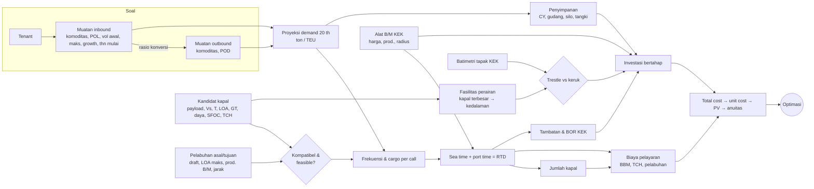

# TPT Planner v2 — Spesifikasi Gambaran Besar

> Status: **DRAF 2** (2026-11-21) — hasil studi file TPT (laporan, PPT, 4 workbook Excel) dan review `apps/` (v1). Semua pertanyaan terbuka & temuan audit sudah diputuskan (§11, §13).
> Dokumen ini adalah *satu-satunya* sumber kebenaran v2. Sengaja dibuat ringkas: kalau ada yang kurang, tambahkan di sini, jangan bikin dokumen baru.
> Pendamping: [02_ROADMAP.md](02_ROADMAP.md) (tahapan + rekomendasi effort) dan [../blueprint/index.html](../blueprint/index.html) (peta variabel + peta layar interaktif).

---

## 1. Apa yang dibangun

**Aplikasi perencanaan transportasi laut untuk Kawasan Ekonomi/Industri (KEK/KI):** dari data soal (tenant, muatan, pelabuhan asal/tujuan, kandidat kapal, alat bongkar muat, kondisi perairan) aplikasi menghitung — dan bisa mengoptimasi — **armada kapal per rute** dan **kebutuhan terminal khusus (TERSUS/TUKS) di KEK** selama periode tinjauan (default 20 tahun), dengan biaya yang bisa dilacak sampai ke rumus dan input asalnya.

Satu kalimat produk:

> *"Excel TPT, tapi setiap angka bisa diklik untuk melihat dari mana asalnya, setiap parameter bisa digeser untuk melihat dampaknya, dan optimasinya dijamin optimum global."*

Tiga cara pakai yang harus didukung oleh **engine yang sama**:

| Mode | Pengguna memilih | Aplikasi menghitung |
|---|---|---|
| **Manual** | kapal per rute, alat B/M per terminal, trestle/keruk | seluruh rantai: frekuensi → armada → biaya → tambatan → investasi → unit cost |
| **Bandingkan** | satu rute | semua kandidat kapal feasible untuk rute itu, berdampingan (melihat trade-off) |
| **Optimasi** | objektif + batasan | kombinasi keputusan dengan total biaya minimum, plus penjelasan "kenapa" |

---

## 2. Pelajaran dari v1 dan prinsip v2

### 2.1 Diagnosis v1 (`apps/`)

v1 secara konsep domain sebenarnya cukup lengkap (dokumen `apps/docs/*` ~28.000 baris), tapi arah pengerjaannya membuat inti produk tidak pernah terlihat:

1. **Backend/database-first.** 6 fase habis untuk PostgreSQL + Alembic + CRUD (project, scenario, commodity, tenant, cargo flow, port, route, bathymetry, vessel). Satu-satunya hasil kalkulasi yang terlihat baru proyeksi demand. Rantai inti (frekuensi → armada → biaya → terminal → optimasi) belum ada.
2. **Navigasi berorientasi data master, bukan alur pengerjaan TPT.** Kapal & pelabuhan eksternal jadi halaman global di luar studi kasus; tab skenario berisi hal yang tidak ada di soal ("Simulasi Jaringan", "Finansial & Tarif") sementara langkah yang ada di soal (pemilihan alat B/M, fasilitas perairan, trestle vs keruk, staging investasi) belum punya tempat yang jelas.
3. **Interaksi antar variabel tidak kelihatan.** UI-nya form + tabel CRUD. Padahal nilai utama aplikasi ini justru "geser satu parameter → lihat efek berantai".
4. **Spesifikasi terlalu besar dan generik** ("professional planning platform"), sehingga agen cenderung membangun infrastruktur, bukan model TPT.
5. **Terikat environment NixOS** (`nix develop`, path `/home/...`) — tidak jalan di mesin Windows ini.

### 2.2 Prinsip v2

| # | Prinsip | Konsekuensi |
|---|---|---|
| P1 | **UI-first dengan placeholder.** Semua layar dibuat dulu dengan data contoh (kasus K15 Batam) dan angka dummy yang ditandai jelas. | Bentuk produk & alur disepakati sebelum engine ditulis. |
| P2 | **Satu dokumen kasus (Case) = satu file JSON.** Tidak ada database di awal. | Tidak ada CRUD/backend sampai benar-benar perlu. Import/export file. |
| P3 | **Engine murni (pure functions) di Python**, dipanggil UI lewat API tipis (FastAPI). Input Case → output lengkap per tahun. | Mudah dites (pytest), dekat dengan ekosistem data (openpyxl, HiGHS); tanpa database. |
| P4 | **Setiap variabel terdaftar di Registry** (id, label, satuan, rumus, dependensi, asal sheet Excel). | Peta variabel, panel "kenapa angka ini?", dan audit jadi otomatis. |
| P5 | **Golden test terhadap Excel K15** untuk bagian yang tidak terdampak temuan audit; bagian yang dikoreksi (§11) dites dengan hitungan tangan dan selisihnya vs Excel dijelaskan. **Tidak ada mode "kompatibel Excel".** | Kepercayaan terhadap angka tanpa membawa bug lama. |
| P6 | **Optimasi = koefisien hasil engine + solver MILP.** Bukan GA/Evolver. | Optimum global terjamin & bisa dijelaskan. |
| P7 | **Ikuti alur pengerjaan TPT** (Gambar 3-1 laporan K15): Muatan → Kapal → Operasi → Biaya → Terminal → Investasi → Optimasi. | Navigasi = urutan berpikir mahasiswa/perencana. |

---

## 3. Domain dalam satu halaman



**Aliran muatan (flow)** adalah unit utama perhitungan: `tenant × arah (inbound/outbound) × komoditas`. Kasus K15 punya 10 flow (5 tenant × in/out). Setiap flow punya rute ke KEK, satu bentuk muatan, dan (dalam mode manual) satu kapal terpilih.

**Bentuk muatan (cargo form):** `CC` curah cair · `CK` curah kering · `PK` petikemas · `GC` general cargo. **Tipe kapal** adalah daftar per kasus (default: tanker, bulk carrier, kapal petikemas, general cargo, **LCT/tongkang**) dengan matriks kompatibilitas bentuk muatan × tipe kapal yang bisa diedit (mis. pelat baja → GC, petikemas, atau LCT).

**Armada homogen:** satu flow dilayani satu kapal terpilih (jumlah unitnya bisa >1). **Rute bolak-balik:** inbound `A-K-A`, outbound `K-F-K`; struktur data rute disiapkan supaya rute segitiga `A-K-F` bisa ditambahkan nanti.

**Terminal di KEK** dikelompokkan: **Multipurpose (MP)** melayani PK + GC + CK (HMC), **Curah cair (CC)** = jetty + MLA. Pengelompokan ini harus bisa diubah per kasus.

---

## 4. Kontrak data (isi file Case)

Semua input yang ada di Excel, dikelompokkan. Kolom "Asal" = sheet sumber di workbook K15 (kecuali disebut lain).

### 4.1 Kasus & parameter global — sheet `Model` (blok asumsi), `Investasi`
| Field | Contoh K15 | Catatan |
|---|---|---|
| nama KEK, lokasi, pelabuhan KEK | KI Batam, Batu Ampar | |
| periode tinjauan, tahun dasar | 20 th | |
| AT, WT, IT (jam/call) | 2, 2, 2 | K15 memakai total 6 jam/call |
| hari kerja/th, jam kerja/hari | 365, 24 | |
| commission days kapal/th | 365 | |
| BOR maks | 70 % | |
| MCR | 80 % | |
| % konsumsi ME/AE di laut/pelabuhan | ME laut 1, ME port 0, AE laut 0, AE port 1 | |
| harga & berat jenis BBM | MFO 18.600 Rp/l (890 kg/m³), HSD 24.000 Rp/l (832 kg/m³) | |
| jenis BBM per mesin | ME = HSD, AE = HSD | parameter (A6); K15 memakai AE = MFO |
| rasio V_ballast / Vs | 100 % | parameter global, bisa dioverride per kapal (A5); K15 memakai 130 % |
| α payload · α batas berat per TEU | 85 % DWT · 90 % DWT | dua parameter terpisah (A8) |
| kapasitas TEU default | ⌊0,85 · DWT / 20 t⌋ | dua parameter; dipakai bila `ships[].teu_capacity` kosong |
| rasio dermaga / LOA minimum | 85 % | kapal layak bila dermaga terpanjang ≥ 85 % LOA |
| kurs USD | 15.521 | |
| WACC / discount rate | 10 % | |
| kenaikan harga satuan/th | | escalation investasi |
| horizon staging | pendek 0–5, menengah 6–10, panjang 11–20 | PM 51/2015 |

### 4.2 Tenant & aliran muatan — sheet `Muatan`, `Proyeksi Muatan`
| Field | Contoh |
|---|---|
| tenant: nama, bidang | PT. Damai Sejahtera, makanan |
| flow inbound: komoditas, bentuk muatan, POL, vol awal, vol maks, satuan (ton/TEU), growth/th, tahun mulai | Jagung karung, GC, Badas, 3.000.000 t, 7.900.000 t, 5 %, th-1 |
| flow outbound: komoditas, bentuk muatan, POD, **aturan volume** | Tepung jagung, PK, Bangkok |
| aturan volume outbound | (a) rasio berat thd inbound (85 %, 55 %, 0,3 t NPI/t nikel), (b) rasio TEU (1 TEU Al = 2 TEU baja ringan), (c) volume sendiri |
| satu tenant boleh punya >1 flow per arah | K24: HSD + Avtur |

### 4.3 Komoditas & konversi ton↔TEU — sheet `Muatan`
massa jenis, stowage factor, kemasan (dimensi & berat per karung/kardus/batang, isi per kemasan), dimensi & tare petikemas 20'/40', rasio 20'/40'. Turunan: **ton per TEU** (lihat §5.1).

### 4.4 Pelabuhan eksternal (asal/tujuan) — sheet `Data Pelabuhan`, `Rute`
nama, negara, jenis terminal, **kedalaman/draft maks**, LOA maks, **produktivitas B/M** dengan mode input per pelabuhan — *total per kapal* (t/j atau TEU/j) **atau** *per alat × jumlah alat* (A3), komoditas yang dilayani, **jarak ke KEK (NM)**, AT/WT/IT khusus (opsional), tarif pelabuhan (§4.8).

**Dermaga vs LOA:** dermaga boleh lebih pendek dari kapal; kapal layak bila `dermaga terpanjang ≥ berth_loa_min_ratio · LOA` (default 85 %, wajar terutama untuk dermaga dolphin 1 dermaga 1 kapal). `max_loa_m` hanya diisi bila ada batas LOA eksplisit.

### 4.5 Tapak TERSUS di KEK — sheet `Trestle`, `Fasilitas Perairan`
profil batimetri (jarak dari garis pantai → kedalaman) dengan sumber `survei | peta_navigasi | dummy` (K15: dummy yang dikunci ke angka K15, siap diganti), panjang trestle maks, harga satuan trestle (Rp/m²), keruk (Rp/m³), dermaga MP (Rp/m²), jetty CC, lebar tambatan, panjang unit tambatan (MP 300 m; CC sesuai jetty).

### 4.6 Kandidat kapal — sheet `Data Kapal`, `TCH`
| Field | Catatan |
|---|---|
| tipe kapal | dari daftar tipe kapal kasus (termasuk LCT/tongkang) |
| IMO, nama, klasifikasi | |
| LPP, LOA, B, T, H | T → draft check; LOA → panjang tambatan & jumlah alat |
| Vs, V ballast | V ballast = rasio global × Vs (default 100 %), atau diisi per kapal |
| DWT, payload (ton) / kapasitas TEU, GT | payload default = α · DWT; kapasitas TEU diisi manual bila data riil diketahui, kosong = rumus parameter |
| daya ME, daya AE | AE default 50 % ME |
| SFOC ME/AE | lookup dari rentang daya (tabel di sheet `Data Kapal`) |
| **TCH** | regresi linier `TCH/hari = a·ukuran + b` per tipe kapal (ukuran = DWT atau TEU), dari tabel tarif charter |

### 4.7 Alat bongkar muat — sheet `Alat BM`
nama (Liebherr LHM 180…600, EMCO Wheaton / Shanghai Eminent MLA), tipe (HMC/MLA/…), harga, **produktivitas per bentuk muatan** (GC t/j, PK box/j, CK t/j, CC t/j), radius jangkauan (m). Aturan jumlah alat per tambatan dari LOA (K15: <90 m→1, 90–160→2, 160–180→3, 180–350→4).

### 4.8 Tarif pelabuhan — sheet `Biaya Pelabuhan`
per pelabuhan (termasuk KEK): labuh (per GT per kunjungan; dalam/luar negeri), pandu (tetap + variabel per GT per gerakan), tambat (per GT per etmal; beton/dolphin), tunda (per GT range), bongkar muat (per ton / per TEU).

### 4.9 Parameter penyimpanan — sheet `Fasilitas Daratan`
per komoditas: dwelling time (hari), tinggi tumpukan/ratio, YOR/occupancy, f_area, f_bulk, A_TEU, kapasitas silo/tangki, porsi inbound yang masuk penyimpanan (K21: 50 %) dan outbound (100 %).

---

## 5. Rantai kalkulasi (kanonis)

Setiap baris tabel di bawah = satu variabel di registry (`engine/src/tpt_engine/registry.py`, §9.3); id registry dipakai UI untuk jejak.

Notasi: flow `f`, tahun `t`, kapal `k`, alat `e`, terminal `τ ∈ {MP, CC}`. Semua output per tahun kecuali disebut lain. ⌈·⌉ = ROUNDUP, ⌊·⌋ = ROUNDDOWN.

### 5.1 Demand & konversi muatan
| Variabel | Rumus | Asal |
|---|---|---|
| `D[f,t]` demand | 0 jika t < t₀; `V₀` di t₀; `min(Dmax, D[t-1]·(1+g))` | Proyeksi Muatan |
| outbound | `r · D_in[t]` (aturan volume §4.2) | Proyeksi Muatan |
| `nBox` per TEU | `min(⌊Lc/l⌋·⌊Wc/w⌋·⌊Hc/h⌋, ⌊NetMax/w_box⌋)` | Muatan |
| `tonPerTEU` | `nBox · w_box` bila ada data kemasan; selain itu `Vc/SF` (atau `Vc·ρ`); selalu ≤ `NetMax` | Muatan |
| `NetMax` | `min(payload kontainer, 0,9·DWT_k / TEU_k − tare)` → **bergantung kapal** | Muatan |
| `D_TEU` | `⌈D_ton / tonPerTEU⌉`; flow yang sudah dalam TEU: `⌈D⌉` — dibulatkan **sekali**, setelah proyeksi kontinu (A12) | Proyeksi Muatan |

**Implementasi Tahap 4 (2026-11-22)** — `tpt_engine/calc/demand.py` (`demand_base`, `demand_ratio`, `project_flows`), `calc/cargo.py` (`net_max`, `box_per_teu`, `ton_per_teu`, `demand_unit`), `calc/vessel.py` (`teu_capacity`, didahulukan dari Tahap 5 karena dipakai NetMax), orkestrasi `calc/run.py` (`calculate(case, modules, plan_id, ship_by_flow)`). Variabel bergantung kapal memakai kapal per flow dari plan (default plan pertama kasus) + override dari UI. `D` disimpan kontinu dalam satuan flow; `V₀` ikut dibatasi `Dmax`; rantai flow rasio boleh bertingkat (siklus ditolak). Kemasan dimuat sesuai orientasi input (tanpa rotasi). Validasi K15 (`tests/test_calc_demand.py`): 6 flow ton & proyeksi out.fantasi = Excel persis; tonPerTEU tepung jagung/terigu/aluminium = Excel; selisih hanya A12 (out.damai th-1 +1 TEU, in/out.fantasi ≤ 6 TEU). Baja ringan: Excel memakai SF 0,6 (`Muatan!C75`, tidak ada di kasus) → 9,749 t/TEU; engine dari kemasan batang → 2.156 batang = 9,745 t/TEU (tidak di golden; flow TEU sehingga tak memengaruhi D).

### 5.2 Kandidat & kelayakan kapal
| Variabel | Rumus |
|---|---|
| `payload[k]` | GC/CK/CC: `α·DWT` (α 0,85–0,9), opsional dibatasi volume ruang muat/SF; PK: `teu_capacity` atau `⌊0,85·DWT / 20⌋` (cek `TEU·tonPerTEU ≤ 0,9·DWT`) |
| `compatible[f,k]` | tipe kapal k ∈ tipe yang diizinkan untuk bentuk muatan f (matriks, bisa diedit) |
| `feasible[f,k]` | compatible ∧ `T_k ≤ draft pelabuhan eksternal` ∧ `dermaga terpanjang ≥ 0,85·LOA_k` ∧ `LOA_k ≤ max_loa` (bila diisi) ∧ (opsional) `T_k·(1+UKC) ≤ kedalaman rencana KEK` |
| `nEq[k]` | jumlah alat/tambatan dari tabel rentang LOA |
| `reach_ok[k,e]` | radius alat ≥ kebutuhan jangkauan (≈ B kapal + margin) — **ditunda ke Tahap 7** (margin belum ada di kasus) |

**Implementasi Tahap 5 (2026-11-22)** — `calc/vessel.py`: `payload` (TEU = kapasitas TEU efektif; ton = isian atau α·DWT; cek berat per TEU sudah dijamin NetMax §5.1), `compatible`, `feasibility` (per pelabuhan eksternal di rute: draft, dermaga terpanjang ≥ rasio·LOA, LOA maks; panjang dermaga kosong → LOA tidak dicek, dicatat sebagai *notes*; kedalaman KEK tidak membatasi karena dirancang mengikuti kapal di Tahap 8), `n_equipment` (rentang `[min, max)`, di atas rentang terakhir = rentang terakhir, dibatasi `max_per_berth` terminal), `ballast_speed`. Kecepatan = Vs kapal; keputusan kecepatan (dv.speed, I2) **ditunda** (keputusan pengguna).

### 5.3 Operasi pelayaran — sheet `Model` baris 28–235
| Variabel | Rumus | Satuan |
|---|---|---|
| `F_req` frekuensi | `⌈D / payload⌉` | call/th |
| `q` cargo per call | mode *full-load*: `payload`; mode *interval*: `D / F` | ton/TEU |
| `tPortKEK` | `q / (prod_e,form · nEq) / 24` | hari/call |
| `tPortExt` | `q / prodTotal_port / 24`; `prodTotal` = angka total per kapal **atau** `prod_per_alat · nAlat_port`, sesuai mode input pelabuhan (A3) | hari/call |
| `tFix` | `(AT+WT+IT)/24` | hari/call |
| `tSea` | `(jarak/Vs + jarak/V_ballast) / 24` | hari/call |
| `RTD` | `tSea + tPortKEK + tPortExt + tFix` | hari |
| `F_max` per kapal | `⌊CD / RTD⌋` (K15 memakai ⌈⌉ — temuan audit) | call/kapal/th |
| `N_ship` | `⌈F_req / F_max⌉` | unit |
| `lamaKonsumsi` | `q / (D/365)` | hari stok per pengapalan |
| utilisasi kapal (metrik) | `F_req / (N_ship · F_max)` | – |

**Implementasi Tahap 5 (2026-11-22)** — `calc/voyage.py` + `run.voyage_chain`. Terminal flow = terminal KEK yang melayani bentuk muatannya; alat = `plan.equipment_by_terminal` (+ override). Arah: inbound = bongkar di KEK / muat di asal, outbound sebaliknya (`ProdRate.unload/load`). Laju dikonversi ke satuan kapal: box/j → TEU/j lewat `share_20ft` (TEU per box = s + 2(1−s); K15 = 1), t/j ↔ TEU/j lewat tonPerTEU. Pelabuhan eksternal = ujung non-KEK leg bermuatan; `tSea` = Σ leg (Vs bila bermuatan, V ballast bila kosong). `tFix` sekali per call. Tahun tanpa demand: semua seri 0 (seperti Excel). Excel menyimpan port time sebagai hari/tahun (`Model!M68`, `M82`) dan `tFix` di dalam port time per call (`M182`); engine hari/call. Validasi (`tests/test_calc_voyage.py`, `tests/excel_k15.py`, `tools/diff_k15.py`): tiruan rumus Excel mereproduksi golden K15 persis (10 flow × 11 seri × 20 th), dan tiruan yang sama + koreksi A1, A2, A3, A5, A10, A13 + D_TEU engine (A12) = engine persis → setiap selisih vs Excel terjelaskan. Contoh tahun pertama: jumlah kapal berubah di in.baru (4→5, A5), out.damai & out.fantasi (3→4, A3), out.esa (2→1, A2), out.baru (3→4, A10).

### 5.4 Biaya pelayaran — sheet `Model` 246–338, `TCH`, `Biaya Pelabuhan`
| Variabel | Rumus |
|---|---|
| BBM ME | `P_ME · MCR · SFOC_ME · tSea·24 · F · %ME_laut` (+ porsi di pelabuhan) → liter via berat jenis → × harga; **F = frekuensi aktual** (A9), jenis BBM = parameter (default HSD) |
| BBM AE | `P_AE · SFOC_AE · (tPort+tFix)·24 · F · %AE_port` → liter → × harga; jenis BBM = parameter (default HSD) |
| Voyage cost | BBM ME + BBM AE |
| TCH | `(a_tipe·ukuran_k + b_tipe) · kurs · CD · N_ship` |
| Biaya pelabuhan | `F · Σ_{pelabuhan∈{ext, KEK}} [labuh(GT) + pandu(GT, gerakan) + tambat(GT, etmal) + tunda(GT) + B/M(q)]` |
| **Shipping cost** | voyage + TCH + biaya pelabuhan (+ CHC bila dipisah) |
| biaya pelayaran per satuan (metrik) | `shipping cost / D`, satuan flow (A7) — kolom Rp/t layar 6–7 |

**Implementasi Tahap 6 (2026-11-22)** — `calc/shipcost.py` + `run.cost_chain`; modul API `shipcost` (menarik `voyage`, `demand`).
- **BBM:** `P · MCR · SFOC · 24 · (tSea · porsi laut + (tPort + tFix) · porsi pelabuhan) · F ÷ berat jenis`, satu rumus untuk ME dan AE — MCR = faktor beban kedua mesin (K15: porsi ME laut 1/pelabuhan 0, AE laut 0/pelabuhan 1 → identik dengan Excel, yang mengalikan MCR ke AE). SFOC dari rentang daya (rentang terakhir dengan `min_kw ≤ P`, seperti MATCH Excel), P_AE default 50 % P_ME. Berat jenis & harga dari `params.fuels` sesuai `me_fuel`/`ae_fuel` (A6, default HSD). F = frekuensi aktual (A9).
- **TCH:** regresi linier kuadrat terkecil per tipe kapal (= SLOPE/INTERCEPT Excel); ukuran = DWT, atau kapasitas TEU efektif untuk tipe `size_basis = teu`; biaya = tarif · kurs · CD · N_ship. Tipe dengan < 2 titik tarif (LCT) → galat data. Tarif TCH & SFOC = Excel untuk ke-41 kapal (dites).
- **Biaya pelabuhan per call** (keputusan pengguna 2026-11-22): labuh/GT per kunjungan; pandu & tunda `(tetap + var·GT) × 2 gerakan` (masuk + keluar; tunda per rentang GT); tambat `tarif/GT/etmal · GT · ⌈tPortExt⌉ etmal` (lama sandar di pelabuhan itu, dibulatkan ke etmal); B/M `q × tarif per ton` (atau per TEU untuk petikemas) **masuk** shipping cost. Pelabuhan luar negeri memakai kolom USD × kurs (A14). TERSUS KEK `port_charges = none` → 0; bila `tariff`, kelas `kek_site.tariff_class`, dalam negeri, beton, lama sandar `⌈tPortKEK⌉`. Biaya per tahun = per call × F (A11). Rincian per komponen ikut di respons (`port_breakdown`).
- **Validasi:** tiruan rumus Excel (`tests/excel_k15.py`) mereproduksi golden BBM, TCH, biaya pelabuhan, shipping cost persis (toleransi 1e-6 karena konstanta liter/ton Excel dibulatkan) dan tiruan + koreksi A6, A9, A11, A14, A15 (+ koreksi Tahap 5) = engine persis; hitungan tangan in.damai (Badas, dalam negeri) & out.damai (Bangkok, luar negeri).

### 5.5 Terminal KEK: tambatan, BOR, alat — sheet `Model` 104–152, 361–377
| Variabel | Rumus |
|---|---|
| `shipDays[f]` | `F · tPortKEK` (+ tFix sesuai konvensi) |
| `berthDaysReq[f]` | `⌈shipDays · LOA_k / L_unit,τ⌉` |
| `nBerth[τ]` | `⌈Σ_f∈τ berthDaysReq / (BOR_max · WD)⌉` |
| `BOR[τ]` | `Σ shipDays / (nBerth · (Σ shipDays / Σ berthDaysReq) · WD)` |
| panjang dermaga | `nBerth[MP] · L_unit,MP`; jetty CC per tambatan |
| `nAlat[τ]` | `nBerth[τ] · nEq(kapal terpanjang di τ)`; penambahan per tahun |

### 5.6 Penyimpanan — sheet `Fasilitas Daratan`
| Fasilitas | Rumus (Q = arus/th yang masuk penyimpanan) |
|---|---|
| Lapangan penumpukan PK | `A = Q_TEU · Tdw · A_TEU / (365 · H_ratio · YOR)`; ground slot `= Q·Tdw / (365 · YOR · H_max)` |
| Gudang/lapangan GC | `A = Q · Tdw · f_area · f_bulk / (365 · ρ · H · YOR)` |
| Curah kering (lapangan/silo) | `A = Q · Tdw · f_area / (365 · ρ · H · YOR) · Rc`; `V_silo = Q·Tdw·Rc / (365·ρ·YOR)`, `nSilo = ⌈V/cap⌉` |
| Curah cair (tangki) | `V = Q · Tdw / (365 · ρ · occupancy)`, `nTangki = ⌈V/cap⌉` |
| Alat lapangan | `⌈Q / (produktivitas · utilisasi · jam kerja)⌉` per bentuk muatan (golden `Model!K370:K373`) |

### 5.7 Fasilitas perairan & trestle vs keruk — sheet `Fasilitas Perairan`, `Trestle`
**Kapal penentu (governing vessel)** = kapal terpilih dengan T/LOA/B terbesar yang singgah KEK.

| Variabel | Rumus |
|---|---|
| kedalaman perlu | `T_max · (1 + clearance)` (K21: 20 %) |
| lebar alur | 1 jalur `Wm + Wa + 2Wb`; 2 jalur `2(Wm+Wa+2Wb) + Ws` (kelipatan B) |
| panjang alur | `L … 2L` tergantung frekuensi/kondisi |
| radius labuh, pintu masuk, stopping distance, kolam putar, area sandar | `L+6D`, `0,7–1 LOA`, `7–8 LOA`, `1,5–4 LOA`, `1,25 LOA × 1,5 B` |
| `x*` | jarak dari pantai di mana batimetri ≥ kedalaman perlu |
| opsi **trestle** | panjang `x*` (≤ maks) → biaya `x* · lebar · c_trestle` |
| opsi **keruk** | dermaga dekat pantai + volume keruk `Σ luas · (kedalaman perlu − kedalaman eksisting)` → biaya `V · c_keruk` |
| opsi **campuran** | fraksi trestle θ ∈ [0,1] (K24) |

### 5.8 Investasi & staging — sheet `Investasi`, `Model` 361–400
investasi dermaga MP, jetty CC, trestle/keruk, alat B/M, penyimpanan; dibangun **saat dibutuhkan** (inkremental per tahun) atau **per tahap** (pendek/menengah/panjang); harga naik `escalation`/th.

### 5.9 Agregasi & objektif — sheet `Model` 398–408
| Variabel | Rumus (K15) |
|---|---|
| `TC[t]` total cost | Σ shipping cost + investasi (K15: investasi awal dibagi 20 lalu ditambahkan tiap tahun) |
| **NPV total cost** | `Σ_t TC[t] / (1+r)^t` → **objektif default v2** |
| `UC[t]` unit cost | **dipisah per satuan** (A7): `Rp/ton` untuk flow bersatuan ton, `Rp/TEU` untuk flow petikemas — tidak ada satu angka gabungan. Biaya bersama (investasi terminal) dialokasikan ke flow; aturan alokasi diputuskan di Tahap 8 |
| `PV_UC[t]`, anuitas | `UC[t] / (1+r)^t`, `PMT(r, 20, Σ PV_UC)` per kelompok satuan — metrik laporan (cara K15) |

---

## 6. Model optimasi

### 6.1 Formulasi
**Sets:** F flow, K kapal, E alat, T tahun, τ terminal, M mode pengembangan (trestle/keruk/campuran).

**Variabel keputusan**
| Var | Domain | Arti |
|---|---|---|
| `y[f,k]` | {0,1} | kapal k melayani flow f |
| `z[τ,e]` | {0,1} | alat e dipakai di terminal τ |
| `w[m]` | {0,1} (atau θ ∈ [0,1]) | mode pengembangan perairan |
| `nBerth[τ,t]`, `nAlat[τ,t]` | integer | turunan, bisa dijadikan variabel |
| *(opsional)* `s[f,v]` | {0,1} | level kecepatan (slow steaming, catatan K21 "Vs dikurangi biar BBM murah") |
| *(nanti)* armada campuran | integer | >1 tipe kapal per flow |

**Batasan inti:** `Σ_k y[f,k] = 1` · `y[f,k] = 0` jika tidak feasible · `Σ_e z[τ,e] = 1` · alat kompatibel dengan semua bentuk muatan di τ · kedalaman perlu ≥ `T_k·(1+c)·y[f,k]` · BOR ≤ BOR_max (lewat `nBerth` integer) · jangkauan alat ≥ kebutuhan · *(opsional)* interval layanan ≤ lama konsumsi / kapasitas penyimpanan.

**Objektif (bisa dipilih):** **min NPV total cost (default)** · min unit cost. Karena unit cost dipisah Rp/ton dan Rp/TEU, objektif unit cost butuh aturan agregasi (bobot per kelompok atau leksikografis) — diputuskan di Tahap 9.

### 6.2 Strategi penyelesaian
Kopling antar flow hanya lewat (a) alat B/M di terminal (mempengaruhi port time semua flow di τ), (b) kapal penentu (kedalaman → biaya trestle/keruk), (c) jumlah tambatan bersama. Maka:

1. **Engine memprakalkulasi** koefisien biaya & berth-days untuk setiap kombinasi `(f, k, e_τ(f), [v])` — semua nonlinearitas (ROUNDUP, lookup, TCH) selesai di sini.
2. **MILP (HiGHS via `highspy`)** memilih kombinasi dengan variabel biner `x[f,k,e]`, level kedalaman diskret (big-M), dan `nBerth` integer. Ukuran K15: ~10 flow × ≤15 kapal × 10 alat → ribuan biner, kecil untuk HiGHS.
3. **Enumerasi pembanding** (outer: alat × mode × level draft; inner: argmin per flow) untuk validasi & penjelasan.
4. **Bukti konvergensi:** callback HiGHS merekam `(waktu, incumbent, dual bound, gap)` setiap kali solusi membaik / log MIP; layar 10 menggambar incumbent (turun) dan batas bawah (naik) terhadap waktu sampai gap 0 % (pengganti grafik iterasi Evolver; keputusan Milestone A 2026-11-22).
5. **Penjelasan:** untuk tiap flow tampilkan 3 kandidat terbaik + selisih biaya + batasan yang aktif ("kapal X lebih murah tapi draft 12,9 m > 11,5 m Badas").

Ini menggantikan Solver/Evolver (GA) di Excel yang tidak menjamin optimum global.

---

## 7. Interaksi yang WAJIB terlihat di UI

Ini daftar "cerita" yang harus bisa dialami pengguna — dasar desain layar dan uji penerimaan:

| # | Geser/ubah | Efek berantai yang harus terlihat |
|---|---|---|
| I1 | Kapal lebih besar | payload ↑ → frekuensi ↓ → biaya pelabuhan per tahun ↓ · TCH/hari ↑, BBM/hari ↑ · draft/LOA ↑ → bisa gugur di pelabuhan asal · kedalaman KEK ↑ → trestle/keruk ↑ · LOA ↑ → alat per tambatan ↑ · lama konsumsi ↑ → penyimpanan ↑ |
| I2 | Kecepatan | RTD ↓ → jumlah kapal ↓ · BBM ↑ |
| I3 | Alat B/M lebih produktif | port time ↓ → RTD ↓ & berth-days ↓ → tambatan ↓ · harga alat ↑ |
| I4 | Growth / volume maks / tahun mulai | demand per tahun → kapan tambah kapal, tambatan, alat (staging) |
| I5 | Rasio konversi in→out, ton/TEU | volume outbound & jumlah TEU → frekuensi outbound |
| I6 | BOR maks, hari kerja | jumlah tambatan & panjang dermaga |
| I7 | Harga BBM, kurs, tarif pelabuhan | komposisi biaya & bisa mengubah kapal optimum |
| I8 | Batimetri / clearance | trestle vs keruk berpindah |
| I9 | Discount rate | PV & anuitas, preferensi investasi awal vs bertahap |

Pola UI pendukung: **slider/what-if** di samping hasil, **badge delta** (angka berubah berapa vs baseline), **panel jejak** (klik angka → rumus + input + turunan), **grafik trade-off** (unit cost vs ukuran kapal per rute).

---

## 8. Peta layar (UI-first)

Shell: sidebar kiri = langkah pengerjaan (1–10, dengan status ✓/⚠/placeholder) · bar atas = pemilih kasus + skenario + tombol hitung/optimasi · laci kanan = tab **Jejak** (selalu tersedia) | **Review** (catatan koreksi Milestone A, lihat di bawah) | **Pengaturan** (setelan tampilan per pengguna, disimpan di localStorage browser; wadah semua pengaturan berikutnya).

| # | Layar | Isi utama | Interaksi kunci |
|---|---|---|---|
| 0 | **Beranda** | daftar kasus, kasus contoh (K15 Batam, K21 Gresik, K24 Palu), import/export | buka/duplikat kasus |
| 1 | **Soal & Asumsi** | identitas KEK, periode, parameter global (§4.1), tarif | ubah parameter → badge "perlu hitung ulang" |
| 2 | **Tenant & Muatan** | tabel tenant; flow in/out; aturan konversi; kalkulator ton/TEU; grafik proyeksi 20 th | I4, I5 |
| 3 | **Pelabuhan & Rute** | pelabuhan asal/tujuan (draft, LOA, prod.), jarak; peta skematik; tapak KEK + profil batimetri | I8 |
| 4 | **Kapal** | database kandidat per tipe; matriks kompatibilitas bentuk muatan × tipe kapal; filter feasibility per flow (alasan gugur); grafik regresi TCH | lihat kenapa kapal gugur |
| 5 | **Alat B/M** | database alat; produktivitas per bentuk muatan; aturan alat/tambatan dari LOA | I3 |
| 6 | **Armada & Operasi** | per flow: pilih kapal (manual) → kartu rantai frekuensi → port time → sea time → RTD → jumlah kapal; slider tahun; **tabel bandingkan kandidat** + grafik unit cost vs ukuran | I1, I2 |
| 7 | **Biaya Pelayaran** | BBM, TCH, biaya pelabuhan, shipping cost per flow per tahun; komposisi (stacked) | I7 |
| 8 | **Terminal KEK** | tambatan MP/CC & BOR per tahun; jumlah alat; penyimpanan per komoditas; fasilitas perairan; trestle vs keruk (grafik batimetri + garis kedalaman perlu); staging | I6, I8 |
| 9 | **Investasi & Ringkasan Biaya** | jadwal investasi per tahun; total cost; unit cost; PV; anuitas | I9 |
| 10 | **Optimasi** | objektif, variabel yang dioptimasi, batasan on/off → jalankan → hasil vs manual, penjelasan per flow | P6 |
| 11 | **Skenario & Laporan** | bandingkan skenario (KPI berdampingan), sensitivitas (tornado), rangkuman ala sheet `Rangkuman`, export Excel/PDF | |
| 12 | **Peta variabel** (grup sidebar *Telusur*) | graf seluruh registry: kolom input kiri, lajur per modul, posisi horizontal = tingkat dependensi; input ringkas (per entitas) / rinci (per atribut); filter *hanya rantai terpilih*, cari; kanvas **seret = geser, roda = zoom di titik kursor, klik ganda = perbesar**, tombol −/%/+/*Paskan* (20–200 %), simpul terpilih di luar layar digeser ke tengah; tombol **Ruang**: sembunyikan menu kiri (hanya di layar ini) dan tutup laci (memilih simpul tidak membuka laci yang sudah ditutup); tombol I1–I9 | klik simpul → sorot hulu/hilir + laci jejak |

**Konvensi visual (wireframe 2a, `design/wireframe-2a.fig`, draf menunggu review):**
- Kanvas 1440 px: bar atas 56 px · sidebar 240 px · konten 880 px · laci jejak 320 px (selalu terbuka di wireframe). Sidebar, bar atas, laci jejak = komponen OpenPencil.
- **Gaya (2026-11-21, keputusan pengguna + TasteSkill):** palet datar hitam `#000000`, biru `#56BDCC`, hijau `#90B148`, merah `#AA3A36` di atas putih; netral pendukung `#EEEEEE` (permukaan), `#DEDEDE` (garis rambut), `#555555` (teks sekunder). Tanpa bayangan dan gradien; sudut 2 px (badge) / 4 px (tombol, input); bagian dipisah garis rambut, bukan kartu berbingkai di atas latar abu. Font Chivo (teks) + Chivo Mono (semua angka & kode), bobot 400/500 saja, huruf kalimat, minimum 13 px; judul layar 32, judul bagian 20, judul kartu 16/500, teks 14–16, label 13/500 abu, angka KPI mono 28.
- Peran warna: hitam = teks, tombol utama, langkah aktif, simpul hasil akhir · biru = input yang bisa diedit (penanda kotak 6 px), isi slider, baris terpilih, seri data utama · hijau = `dihitung`, layak, input lengkap, delta membaik · merah = gugur, asumsi, perlu hitung ulang, nilai yang melanggar batas, delta memburuk. Biru & hijau kontrasnya ±2:1 di atas putih → hanya sebagai bidang/penanda dengan teks hitam; merah boleh jadi teks.
- Badge angka: `placeholder` abu `#EEEEEE` (angka placeholder ditulis `#555`) · `dihitung` bidang hijau · `input` bidang biru · `asumsi` bingkai merah · `gugur · <alasan>` bidang merah teks putih · `≠ Excel · A#` bingkai hitam. Bentuk muatan = kode mono berbingkai (CC/CK/PK/GC), bukan warna.
- Layar 6: kandidat gugur tetap tampil (redup + alasan), kelayakan = draft ≤ draft maks pelabuhan & LOA ≤ dermaga ÷ 0,85. Rantai hitung tampil sebagai simpul yang bisa diklik → laci jejak.
- Pola semua layar: label langkah mono (`06 · hasil`), judul 32, satu kalimat 16; bagian dipisah garis rambut; nilai input ditandai kotak biru di kepala kolom atau di samping angka; angka hasil abu + badge `placeholder` sampai engine tersambung; baris terpilih = latar `#EEEEEE` + garis biru kiri 3 px.
- Layar 0: kasus aktif + daftar kasus (K21/K24 "belum diekstrak") + import JSON/Excel. Layar 1: identitas, horizon & fase, parameter global dua kolom, contoh status "diubah", tabel asumsi. Layar 3: tabel 10 pelabuhan (LOA maks = dermaga ÷ 0,85 sebagai turunan), batang jarak rute, tapak & kondisi perairan. Layar 4: matriks bentuk muatan × tipe kapal, regresi TCH, tab per tipe kapal dengan kelayakan per pelabuhan. Layar 5: tabel HMC & MLA, aturan alat/tambatan dari LOA, what-if produktivitas (I3).
- Layar 7: slider I7, KPI, batang komposisi TCH/BBM/pelabuhan per flow, rincian per tahun (badge A11). Layar 9: KPI (NPV biaya total = objektif bawaan), slider discount (I9), jadwal investasi bertumpuk, tabel item investasi. Layar 10: objektif, variabel keputusan (§6.1), sakelar batasan, tombol jalankan, tabel hasil vs manual + batasan aktif, tiga kandidat terbaik per flow. Layar 11: tabel skenario berdampingan, tornado sensitivitas, isi ekspor.
- **Review Milestone A batch 1** (2026-11-22): layar 1 — judul kelompok parameter tebal + garis hitam; judul layar menjadi *Soal & parameter*; tabel asumsi & celah data = **panduan development** (disembunyikan bawaan, ditampilkan lewat Pengaturan → *Catatan development*), bukan saklar model. Layar 3 — tabel **Tarif pelabuhan per kelas** (utama, I–V; tab kapal luar/dalam negeri; labuh, pandu tetap/variabel, tambat beton/dolphin, B/M per ton/TEU; tunda per rentang GT per kelas), semua bisa diedit; kelas tiap pelabuhan tetap di tabel pelabuhan. Layar 5 — rentang LOA → alat per tambatan dan batas maksimum alat per terminal bisa diedit; tombol *Tambah alat* (HMC/MLA, id `eq.baru_*`, nama/harga/produktivitas bisa diedit, bisa dihapus). Layar 7 — sumbu nilai berskala dengan satuan di grafik komposisi; pemilih flow (tenant · arah) untuk rincian per tahun; tabel **biaya pelabuhan per call** per komponen (placeholder). Layar 9 — grafik biaya per tahun menumpuk biaya pelayaran + investasi (sumbu Y Rp miliar, sumbu X tahun operasi). Layar 10 — grafik **konvergensi solver** (§6.2 butir 4). Grafik batang/kolom kini bisa menampilkan sumbu dengan satuan (`xUnit`/`yUnit`).
- Layar 3–4 · **Satuan & isian tabel** (2026-11-22): setiap kepala kolom angka memuat satuannya (`Draft maks, m`, `Dermaga terpanjang, m`, `Kecepatan, knot`, `DWT, t`, …). Tabel pelabuhan memuat kolom **Jarak ke KEK, NM** yang bisa diedit (= `routes[].legs[].distance_nm` rute yang menyinggahi pelabuhan itu; pola round trip → kedua leg diisi sama, tanda ≠ bila data pergi/pulang berbeda); grafik batang jarak di bawahnya hanya visualisasi. Tabel kapal memuat kolom **IMO** (`ships[].imo`, tidak dipakai hitungan; digit periksa IMO divalidasi, merah bila salah, tautan ↗ ke MarineTraffic untuk verifikasi). Titik **TCH pasar** diisi per tipe kapal di layar 4 (`ship_types[].tch_points`: kelas pasar | ukuran DWT/TEU | USD/hari, tambah/hapus, min. 2 untuk regresi); TCH tiap kapal = regresi linier titik-titik itu terhadap DWT/TEU kapal (Tahap 6).
- Layar 3 · **Profil batimetri tapak** (2026-11-21): tabel isian *jarak dari pantai (m) | kedalaman (m LWS, positif ke bawah)* = `kek_site.bathymetry`, dengan pilihan sumber (survei / peta navigasi / dummy), tambah/hapus titik (min. 2), **tempel dua kolom dari Excel** (baris judul dilewati, kedalaman negatif dibaca positif), baris merah + tombol *Urutkan* bila jarak tidak naik (syarat validator `Case`). Di sampingnya grafik profil berskala jarak sebenarnya (`BathyProfile`): muka air, area air biru muda, garis dasar biru, garis putus-putus merah = kedalaman perlu (placeholder sampai Tahap 8), garis hitam = ujung trestle; titik baris yang disorot ditebalkan. Grafik yang sama dipakai di layar 8.
- Layar 8: kartu per terminal (MP, CC) + grid staging per tahun (kotak hitam = tahun bangun) + tabel penyimpanan + profil batimetri dengan opsi trestle vs trestle+keruk.

**Jejak & peta variabel (Tahap 3, 2026-11-21):**
- Angka yang bisa ditelusuri = garis bawah titik-titik abu (`Tv` di `web/src/components/trace.tsx`); klik → laci jejak. Angka aktif dibingkai biru 2 px. Semua angka hasil dan input yang tampil di layar 6–9 bisa diklik.
- Laci jejak (dari registry): konteks (flow · kapal · tahun / terminal), label, nilai (input = nilai kasus aktif, hitam; turunan = placeholder abu), badge jenis, simbol + id, **keterangan singkat apa variabel ini**, chip **Tampil di layar** (klik = pindah layar), rumus atau `case_path`, SPEC §, sel Excel; daftar **Dihitung dari** (klik = telusuri ke hulu, konteks tetap), chip **Dipakai untuk menghitung**, keterangan juga muncul sebagai tooltip di angka, masukan, dan simpul peta; jumlah hulu/hilir, tombol "Buka di peta", tombol ← riwayat; catatan `≠ Excel · A#` dari ringkasan audit di registry. Tab Pengaturan bisa menyembunyikan keterangan, catatan ≠ Excel, catatan "tidak ada temuan audit" (bawaan: **tersembunyi**), dan catatan nilai placeholder.
- **Review Milestone A** (2026-11-22): catatan koreksi `{screen, varId?, topic, text, done}` dengan topik nama / keterangan / rumus / dependensi / satuan / data / tampilan / lainnya. Dicatat dari tab Jejak (*Catat koreksi* → terkait variabel yang dilihat) atau tab Review (catatan layar aktif, opsional dikaitkan ke variabel jejak). Tab Review: progres layar ditinjau (x/13, centang per layar), filter layar ini / terbuka / semua, tandai selesai, hapus, *Salin semua (Markdown)*. Sidebar menampilkan jumlah catatan terbuka dan ✓ per layar. Disimpan di localStorage dan, saat dev server berjalan, disinkronkan ke **`v2/review/notes.json`** (plugin Vite `/__review`, GET/POST; versi lebih baru menang) supaya agen bisa membaca dan menerapkan koreksi ke registry/SPEC lalu menandainya selesai.
- Peta variabel: simpul input = penanda kotak biru; keputusan = bingkai putus-putus hitam; turunan/metrik = bingkai garis rambut; objektif = bidang hitam. Sorot: **hulu = bidang biru** (sisi biru 2 px), **hilir = bidang `#EEEEEE` + bingkai hitam** (sisi hitam), terpilih = bingkai biru 2 px, lainnya redup 30 %.

Setiap layar di tahap UI-first menampilkan data K15 (dari JSON contoh) dan angka hasil berlabel **`placeholder`** sampai engine modul itu tersambung (lalu label berubah jadi **`dihitung`** + bisa dilacak).

---

## 9. Arsitektur v2

### 9.1 Stack (diputuskan: React + engine Python, tanpa DB)
| Lapisan | Pilihan | Alasan |
|---|---|---|
| Desain UI | **OpenPencil** via MCP (`D:\LAH\TPT\.mcp.json`) | wireframe Tahap 2a, review lewat komentar kanvas |
| UI | **React + TypeScript + Vite**, Tailwind | ringan, jalan di Windows tanpa Nix |
| State UI | Zustand (atau Context) — `Case` + `Scenario` aktif + hasil hitung terakhir | |
| Grafik | Recharts / ECharts | proyeksi, trade-off, batimetri |
| Peta variabel | React Flow (atau SVG custom) | graf dependensi dari Registry |
| API | **FastAPI**, tipis: `/cases`, `/calculate`, `/compare`, `/optimize`, `/registry` | satu proses lokal |
| Engine | **Python murni** (`tpt_engine`), model data **Pydantic** | satu sumber kebenaran rumus; dites pytest |
| Optimizer | **HiGHS** via `highspy` | MILP optimum global |
| Tipe bersama | OpenAPI dari FastAPI → `openapi-typescript` | tipe TS di UI selalu sinkron dengan Pydantic |
| Persistensi | file JSON kasus di `v2/cases/` (+ upload/download) | tanpa database |
| Excel | openpyxl (ekstraksi K15; import workbook nanti) | |
| Lingkungan | `uv` (Python 3.13) + Node | keduanya sudah ada di mesin ini |

Selama Tahap 2–3 (UI placeholder) web membaca JSON kasus langsung sebagai mock, jadi UI bisa jalan tanpa backend.

**API (Tahap 4, keputusan pengguna 2026-11-22):**
- **Dev:** FastAPI (`uv run --project engine uvicorn tpt_api.app:app`, :8000, konfigurasi `api` di `.claude/launch.json`) berdampingan dengan Vite; Vite mem-proxy `/api` → :8000 (`TPT_API_URL` untuk mengganti target). Semua rute di bawah `/api`; Tahap 13 FastAPI juga menyajikan build web di origin yang sama.
- **Rute:** `GET /api/health`, `GET /api/cases` (file `cases/*.json` + status validasi), `GET /api/cases/{id}`, `POST /api/calculate`, `POST /api/compare` (Tahap 5).
- **`/calculate`:** request `{case, modules: ["demand"], plan_id?, ship_by_flow?}` — kasus aktif dikirim utuh (termasuk editan UI, tanpa state server). Respons **berkunci id registry**: `{modules, plan_id, ship_by_flow, computed: [id…], values: {id: {flow|ship: angka | seri[20]}}, units: {flow: ton|TEU}, warnings}`. `computed` = daftar variabel yang dihitung engine → UI mengganti badge `placeholder` dengan `dihitung`. Modul yang belum ada → 422. Tahap 6: modul `shipcost` (menarik `voyage`), respons menambah `port_breakdown` (flow → komponen → seri Rp/call); `/compare` ikut menghitung biaya tiap kandidat (kolom Rp/satuan layar 6). Tahap 5: modul `voyage` (menarik `demand`), request menerima `equipment_by_terminal`, respons menambah `equipment_by_terminal`, `reasons` (alasan kapal terpilih gugur) dan `feasibility` (flow → kapal kompatibel → `{ok, reasons, notes}`, dipakai layar 4).
- **`/compare` (keputusan pengguna 2026-11-22):** request `{case, flow_id, plan_id?, ship_by_flow?, equipment_by_terminal?}` → `{flow_id, unit, equipment_id, rows: [{ship_id, compatible, feasible, reasons, notes, selected, values: {id registry: angka | seri}, error}]}` untuk semua kapal kasus; rantai §5.1–5.3 dihitung untuk yang kompatibel (termasuk yang gugur, agar posisinya terlihat). Dipanggil hanya oleh layar 6 (`useCompare`), bukan setiap /calculate.
- **Web memilih mock vs API otomatis:** `useEngineSync` (dipasang di App) mengirim kasus ke `/calculate` dengan debounce 300 ms setiap kali kasus/kapal terpilih berubah (dan saat Hitung ulang); bila API tak terjangkau, angka kembali ke placeholder dengan catatan "API tidak aktif" dan dicoba lagi tiap 5 detik. Kasus awal tetap dibundel dari `cases/k15-batam.json` agar UI terbuka tanpa API; `registry.json` tetap mock sampai `/registry`.
- **Tipe:** `tools/export_openapi.py` → `web/src/api/openapi.json` → `npm --prefix web run gen:api` (openapi-typescript, dipasang terpisah di `web/tools/gen-api` karena butuh TypeScript 5 sedangkan web TypeScript 7) → `src/api/openapi.ts`; `src/api/case.ts` hanya alias `components['schemas'][…]`. FastAPI memakai `separate_input_output_schemas=False` agar satu tipe per model. Test gagal bila `openapi.json` basi. Database hanya dipertimbangkan bila nanti butuh multi-user — **bukan** di roadmap ini. Kode v1 tidak dibuang; boleh jadi referensi.

### 9.2 Struktur folder
```
v2/
├─ docs/            01_SPEC.md, 02_ROADMAP.md
├─ blueprint/       index.html (peta variabel & layar, statis)
├─ design/          wireframe-2a.fig (OpenPencil, Tahap 2a), _preview/ (PNG pratinjau)
├─ cases/           k15-batam.json, case.schema.json  ← satu file = satu kasus
├─ engine/          (proyek uv)
│  ├─ src/tpt_engine/domain/     model Pydantic Case/Scenario, satuan
│  ├─ src/tpt_engine/calc/       demand, cargo, vessel, voyage, shipping_cost,
│  │                             terminal, storage, waterside, investment, aggregate
│  ├─ src/tpt_engine/registry.py, trace.py
│  ├─ src/tpt_engine/optimizer/  candidates, enumerate, milp (highspy)
│  ├─ src/tpt_api/               FastAPI (app.py; rute /api/*)
│  └─ tests/                     unit + golden K15
├─ web/             (Vite) src/api (openapi.json → openapi.ts via openapi-typescript, case.ts alias tipe, client.ts), src/screens/S00..S12,
│                   src/components (ui, shell, trace), src/charts, src/lib (case, format, registry),
│                   src/mock (case + placeholders + registry.json), src/store.ts (Zustand)
└─ tools/           extract_k15.py (pemetaan sel khusus K15), export_schema.py, dump_registry.py (registry → web/src/mock/registry.json),
                    export_openapi.py (OpenAPI → web/src/api/openapi.json), check.ps1 (semua cek), dev.ps1 (jalankan API + web lokal),
                    diff_k15.py (laporan selisih engine vs Excel K15 per flow + penyebab, memakai engine/tests/excel_k15.py)
```

### 9.3 Registry & jejak (inti "interaksi variabel")
```python
@dataclass(frozen=True)
class VarDef:
    id: str                    # "voyage.rtd"
    label: str                 # "Round Trip Days"
    unit: str                  # "hari"
    scope: str                 # "global" | "flow" | "flow×year" | "terminal×year" | ...
    kind: str                  # "input" | "derived" | "decision" | "objective"
    formula: str               # teks rumus untuk ditampilkan
    deps: tuple[str, ...]      # id variabel lain
    excel_ref: str | None = None   # "Model!M195"
```
Registry diekspos lewat `/registry`; hasil `/calculate` membawa nilai + `deps` aktual → UI menggambar graf, menyorot hulu/hilir, dan menampilkan "kenapa angka ini".

**Implementasi Tahap 3 (2026-11-21)** — `engine/src/tpt_engine/registry.py`, 173 variabel (100 input, 4 keputusan, 64 turunan, 4 metrik, 1 objektif):
- `VarDef` ditambah: `impl` (Tahap 4: fungsi engine `"modul:fungsi"` di bawah `tpt_engine.calc`, dari `IMPL`; dites dapat diimpor dan sama dengan `calc.run.COMPUTES`), `section` (§ SPEC), `audit` (ID A1–A15), `case_path` (input), `screens` (layar tempat tampil), `symbol`, `note`, `desc` (keterangan 1–2 kalimat untuk pengguna, di `registry_desc.py`; test mewajibkan setiap variabel punya). `kind` ditambah **`metric`** = angka laporan yang tidak dipakai variabel lain (utilisasi, Rp/t pelayaran, BOR realisasi, anuitas).
- Id: input `in.<entitas>.<atribut>`, keputusan `dv.*`, objektif `obj.npv`; turunan `<modul>.<nama>` dengan modul = file `calc/` (demand, cargo, vessel, voyage, shipcost, terminal, storage, waterside, invest, agg).
- **Input per atribut** (keputusan pengguna): satu simpul per field `Case` yang dipakai rumus; `case_path` memakai `nama[kunci]` untuk elemen list yang dipilih konteks (flow, ship, port, route, terminal, equip, …). Tampilan graf bisa meringkasnya per entitas (17 kelompok).
- Turunan = satu per baris rumus §5; beberapa baris dipecah agar jejak berguna (BBM liter vs Rp, port time KEK/ext/total, biaya pelabuhan per call vs per tahun, V ballast/daya AE/SFOC/kapasitas TEU efektif) dan beberapa ditambah: utilisasi, Rp/t pelayaran, alat lapangan, investasi total.
- Ringkasan temuan audit (`AUDIT`) dan interaksi I1–I9 (`INTERACTIONS`, titik awal penelusuran) ikut di registry.
- Test (`engine/tests/test_registry.py`): id unik, deps ada, **tanpa siklus** (Kahn + test deteksi), **tanpa simpul yatim** (input selalu dipakai, turunan selalu punya masukan, hanya metric/objective boleh jadi ujung), semua simpul mencapai metric/objective, objektif dipengaruhi keempat keputusan, §4.1–4.9 & §5.1–5.9 tercakup, `case_path` ada di model `Case`, `web/src/mock/registry.json` sinkron.
- Web membaca `registry.json` (hasil `tools/dump_registry.py`) sebagai mock sampai `/registry` ada. Graf: **SVG custom** (keputusan pengguna; tanpa dependensi baru). Tata letak = lajur per modul (baris) × tingkat dependensi (kolom, `depth`), karena ±70 dependensi berada di dalam modul yang sama sehingga kolom-per-modul tidak bisa mengalir kiri→kanan.

---

## 10. Data referensi

Semua file di bawah ada di `referensi/<kasus>/` (di luar git — milik kelompok lain).

| Kasus | File | Peran |
|---|---|---|
| **K15 — KI Batam** (Febiola & Yudho, 2024) | `TPT_Kelompok 15 Revisi 02-Januari-2025.xlsx`, laporan & PPT K15 | **kasus utama**: contoh data UI + golden test |
| K21 — KI Gresik (2023) | `KELOMPOK 21_…_Perhitungan.xlsx`, laporan, PPT | uji kedua; sumber ide trestle vs keruk, objektif NPV, catatan kelas |
| K24 — KEK Palu (Primo, 2024) | `Perencanaan Transportasi Laut Kelompok 24 (2).xlsx`, PPT PRIMO | uji ketiga; payload volume-limited, θ trestle, 2 komoditas per tenant |
| K7 — Impor jagung hub-spoke | `K7_TPT SOLVER (1).xlsx` | **varian lain** (hub & feeder + penjadwalan harian) → di luar cakupan awal |

---

## 11. Temuan audit Excel K15 & keputusan

Semua temuan sudah diputuskan (tabel keputusan di bawah). Engine v2 **hanya** mengimplementasikan versi terkoreksi; tidak ada flag kompatibel Excel.

| # | Lokasi | Temuan | Dampak |
|---|---|---|---|
| A1 | `Model!M208` dst. | `F_max = ROUNDUP(365/RTD)` — seharusnya ROUNDDOWN | jumlah kapal bisa kurang 1 |
| A2 | `Model!M89`, `M91` (cabang non-PK) | `N48/$DD19*$CI15` → waktu muat **dikali** jumlah alat, bukan dibagi | port time GC/CC outbound di KEK membengkak (×16 untuk 4 alat) |
| A3 | `Model!M82` | waktu muat di pelabuhan asal memakai jumlah alat KEK (`CI8`) × produktivitas pelabuhan | tergantung arti "produktivitas pelabuhan" (per alat atau total?) |
| A4 | `Proyeksi Muatan!H12…`, `O14…` | cek batas maks memakai sel tetap (`$G$12`, `$I$13`) bukan nilai tahun sebelumnya | batas maks tidak bekerja benar (kebetulan tidak terlampaui) |
| A5 | `Data Kapal!L` | V ballast = 130 % Vs | sea time balik terlalu cepat? |
| A6 | `Model!M247/M273` | BBM ME dihitung sebagai HSD, AE sebagai MFO | biasanya kebalikannya |
| A7 | `Model!K404` | unit cost membagi biaya dengan muatan campuran ton & TEU | unit cost tidak sebanding antar tahun |
| A8 | `Muatan!AD`, `Data Kapal!N` | payload 85 % DWT di satu tempat, 90 % di tempat lain | konsistensi |
| A9 | `Model!M247`, `M260` | BBM dihitung dari `F_max × N_ship` voyage (AETOS th-1: 65 × 2 = 130), bukan frekuensi aktual (92) | biaya BBM ±40 % lebih tinggi |
| A10 | `Model!CI8:CI17` | jumlah alat/tambatan di-XLOOKUP dengan **nama alat** ("Alat 7") ke tabel rentang LOA → selalu 4 | aturan LOA→alat tidak pernah aktif |
| A11 | `Biaya Pelabuhan!E71:E128` | biaya pelabuhan berupa **nilai statis** (tidak ikut berubah saat kapal diganti) dan dihitung dengan voyage maks per kapal (65), bukan frekuensi aktual (92) | optimasi Evolver tidak "melihat" biaya pelabuhan; in.damai th-1 dihitung 65 call, seharusnya 92 (kurang ±30 %) |
| A12 | `Proyeksi Muatan!G20:Z24`, `J5…`, `Model!N9` | pembulatan TEU tidak seragam: tahun-1 `ROUNDDOWN` (G20), tahun lain `ROUNDUP`; TEU inbound (fantasi) dibulatkan lalu **dikompounding**; outbound TEU tidak dibulatkan (224.972,8 TEU) | out.damai th-1 kurang 1 TEU; in.fantasi naik ≤ 6 TEU sebelum batas (ditemukan Tahap 4) |
| A13 | `Model!M350:AF359` | lama konsumsi = `ROUNDUP(payload / (D/365))` — memakai payload (bukan muatan per call aktual) dan dibulatkan ke hari | lama konsumsi naik ≤ 1 hari (dwelling time penyimpanan, Tahap 7) (ditemukan Tahap 5) |
| A14 | `Biaya Pelabuhan!E71:AF142` | pilihan tarif membandingkan label `"Dalam Negeri"`/`"Luar Negeri"` dengan `"Dalam"`/`"Luar"` → tidak pernah sama, semua pelabuhan kena tarif **dalam negeri**; baris pandu out.adi (`E93:AF93`) kolomnya terbalik sehingga hanya itu yang memakai tarif luar negeri; tarif labuh luar negeri kelas utama kosong | biaya pelabuhan luar negeri (Visakhapatnam, Melbourne, Bangkok, Kobe, Chennai) jauh terlalu rendah (ditemukan Tahap 6) |
| A15 | `Biaya Pelabuhan!E84…E133` | pandu & tunda dihitung 1 gerakan per call; biaya tetap tunda **tidak dikali frekuensi** (urutan operasi `tetap + var·GT·F`); tambat dikali seluruh port time per call (bongkar muat KEK + asal + AT/WT/IT) | pandu/tunda kurang ±½, tambat bergantung port time KEK yang tidak relevan (ditemukan Tahap 6) |

Verifikasi: dengan rumus di atas (termasuk A1, A9, A10), rantai AETOS tahun-1 rute Badas mereproduksi `Model!M338` = Rp 734,3 M persis — lihat tab 3 blueprint.

### Keputusan (2026-11-21)
| # | Keputusan | Perilaku engine v2 |
|---|---|---|
| A1 | **ROUNDDOWN** | `F_max = ⌊CD / RTD⌋` |
| A2 | **dibagi** jumlah alat | `t = q / (prod · nEq) / 24` untuk semua bentuk muatan |
| A9 | **frekuensi aktual** | BBM dihitung dari `F` voyage, bukan `F_max · N_ship` |
| A10 | **dari LOA** | `nEq` = tabel rentang LOA kapal terpilih |
| A3 | **input per pelabuhan** | tiap pelabuhan memilih mode produktivitas: *total per kapal* atau *per alat × jumlah alat* |
| A4 | **diperbaiki** (jelas bug) | batas maks dicek terhadap nilai tahun sebelumnya: `min(Dmax, D[t−1]·(1+g))` |
| A5 | **parameter, default 100 %** | `V_ballast = rasio · Vs`, rasio global bisa dioverride per kapal |
| A6 | **ME & AE = HSD, sebagai parameter** | jenis BBM per mesin bisa dipilih; default keduanya HSD |
| A7 | **dipisah per satuan** | unit cost Rp/ton dan Rp/TEU terpisah; objektif default NPV total cost |
| A8 | **dua parameter** (default saya, bisa diubah) | α payload = 85 % DWT; α batas berat per TEU = 90 % DWT |
| A11 | **dihitung dari tarif × frekuensi aktual** (sejalan A9) | jasa labuh/pandu/tambat/tunda/B-M dari `tariffs` × `F`; TERSUS KEK tanpa jasa kepelabuhanan (`kek_site.port_charges = "none"`) |
| A12 | **⌈·⌉ sekali** (jelas bug, sejalan rumus §5.1) | proyeksi kontinu dalam satuan flow; `D_TEU = ⌈D_ton/tonPerTEU⌉` atau `⌈D⌉` di semua tahun |
| A13 | **ikut rumus §5.3** (q / (D/365), kontinu) | pembulatan hari, bila perlu, diputuskan di penyimpanan (Tahap 7) |
| A14 | **tarif sesuai jenis pelabuhan** (jelas bug) | luar negeri = kolom USD × kurs, dalam negeri = kolom Rp; satu rumus untuk semua komponen |
| A15 | **2 gerakan, tambat ⌈tPortExt⌉ etmal, tunda tetap per call** (keputusan pengguna 2026-11-22) | pandu & tunda × 2 (masuk + keluar); tambat dari lama sandar di pelabuhan itu dibulatkan ke etmal; B/M tetap masuk shipping cost |

**Data kasus:** celah data & asumsi ekstraksi K15 (batimetri, dermaga eksisting, mode produktivitas pelabuhan, batas LOA, kapasitas TEU, dll.) dicatat di `cases/k15-batam.json → assumptions`, bukan di dokumen ini.

**Konsekuensi untuk golden test:** angka K15 yang terdampak A1–A3, A5, A6, A9–A15 (port time, RTD, jumlah kapal, BBM, biaya pelabuhan, pembulatan TEU, lama konsumsi) tidak akan sama dengan Excel. Bagian itu dites dengan hitungan tangan; laporan validasi mencatat selisih per flow vs Excel beserta penyebabnya (Tahap 5: `tools/diff_k15.py`).

---

## 12. Di luar cakupan (sekarang) & ekstensi nanti
- Varian hub-and-spoke / feeder multi-port (K7) dan rute segitiga asal→KEK→tujuan (disebut di laporan K15 tapi Excel memakai rute bolak-balik terpisah; struktur data sudah disiapkan).
- Armada campuran (>1 tipe kapal per flow).
- UI dua bahasa (v2 berbahasa Indonesia saja).
- Simulasi penjadwalan harian & inventori (K7 `Penjadwalan`).
- Layout AutoCAD (cukup ringkasan dimensi), analisis lingkungan/oseanografi.
- Multi-user, login, server.
- Perhitungan jarak otomatis dari peta.
- Kecocokan alat B/M per bentuk muatan di dermaga MP (mis. GC pakai HMC, CK pakai grab/conveyor) — sekarang semua muatan MP memakai HMC; dicatat dari review Milestone A (2026-11-22).

---

## 13. Keputusan (dulu pertanyaan terbuka) — 2026-11-21
| # | Topik | Keputusan |
|---|---|---|
| 1 | Kasus utama | **K15 KI Batam** (data contoh UI + golden test); K21 & K24 di Tahap 12 |
| 2 | Objektif | **bisa dipilih, default NPV total cost**; unit cost (Rp/ton & Rp/TEU terpisah) sebagai alternatif |
| 3 | Bug Excel | **langsung versi terkoreksi**, tanpa flag kompatibel Excel (§11) |
| 4 | Armada | **homogen dulu**; campuran = ekstensi |
| 5 | Rute | **bolak-balik dulu** (A-K-A, K-F-K); data rute siap untuk segitiga |
| 6 | Stack | **React (Vite) + engine Python (FastAPI), tanpa DB** (§9) |
| 7 | LCT | **ya** — daftar tipe kapal & matriks kompatibilitas bisa diedit per kasus |
| 8 | Bahasa UI | **Indonesia**, istilah teknis tetap (RTD, BOR, TCH, DWT, LOA) |

Belum diputuskan (dijadwalkan): aturan alokasi biaya bersama ke flow untuk unit cost (Tahap 8); agregasi objektif unit cost (Tahap 9).
